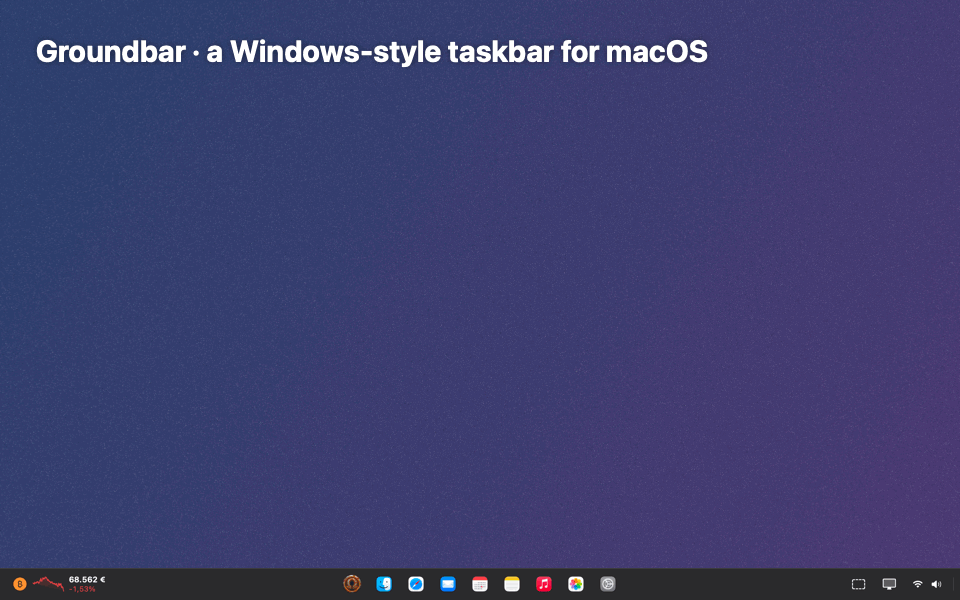
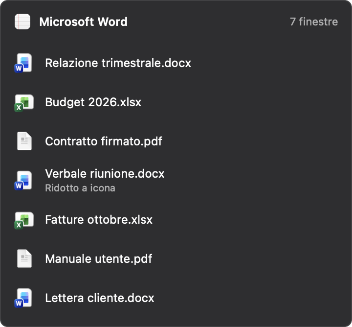
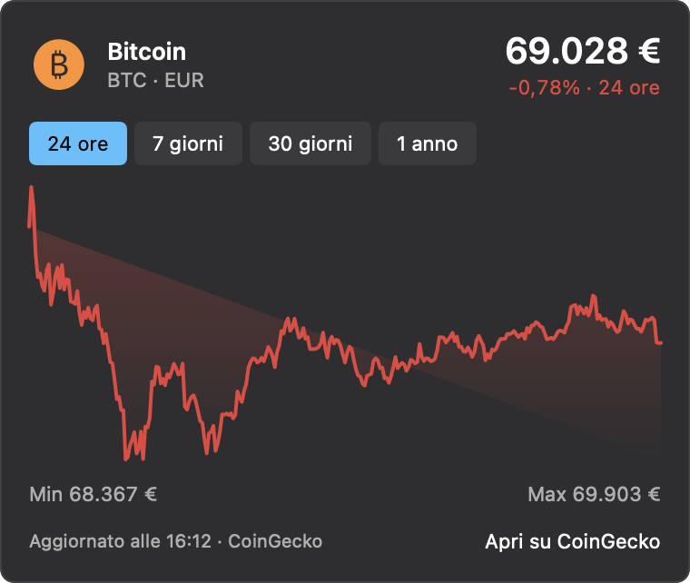
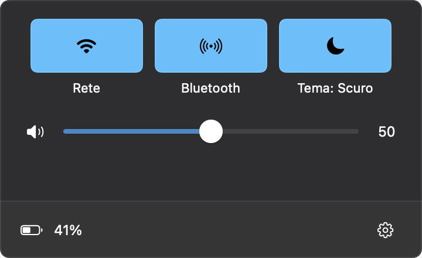

# Groundbar

[English](README.md) · **Italiano**

Una barra delle applicazioni per macOS in basso sullo schermo, con menu Start, elenco dei documenti aperti per ogni app, file recenti, widget Bitcoin e temi. Scritta in Swift/SwiftUI + AppKit, senza dipendenze esterne.

Disponibile in **italiano** e **inglese**: Groundbar segue la lingua impostata in macOS.

*Groundbar si chiamava OmniBar fino alla versione 0.2.0.*



## Funzioni

- **Menu Start**: app usate di recente, *Consigliati* con i file aperti di recente, *Tutte le app*, ricerca di app **e file** (Invio apre, ↑↓ per scegliere), menu di arresto.
- **App fissate e aperte** in un'unica barra, con indicatore dell'app attiva. Le app non fissate compaiono solo finché hanno finestre aperte.
- **Elenco dei documenti per app**: passando sopra un'icona o cliccandola si vedono tutti i documenti aperti, anche quelli ridotti a icona. Un clic porta in primo piano il documento scelto, la ✕ lo chiude.
- **Documenti recenti** nel clic destro su ogni app (Word, Excel, lettore PDF…).
- **Cartelle e file fissati**: trascinali sulla barra.
- **Screenshot** di una porzione o di tutto lo schermo, salvati e copiati negli appunti.
- **Widget Bitcoin**: prezzo in euro, variazione e grafico delle 24 ore. Con un clic si apre un grafico da 24 ore a 1 anno (dati CoinGecko).
- **Impostazioni rapide**: rete, volume, batteria, tema.
- **Mostra desktop**, sul bordo destro della barra.
- **Temi**: Sistema, Chiaro, Scuro, **Halloween** 🎃, **Natale** 🎄 (neve che scende e lucine) e **Babbo Natale** 🎅 (cielo notturno con la slitta che attraversa la barra).
- **Scorciatoie**: ⌃⌥1…9 apre l'app n-esima, ⌃⌥Spazio apre Start, ⌃⌥D mostra il desktop.
- **Avvio automatico** con il Mac, da attivare dal menu del clic destro sulla barra.
- **Finestra Impostazioni**: tema, disposizione delle icone, widget Bitcoin e valuta (EUR/USD), pulsanti screenshot, scorciatoie, aggiornamenti.
- **Avvisi di aggiornamento**: una volta al giorno Groundbar controlla su GitHub e ti avvisa quando esce una nuova versione (non installa mai niente da sola).

| Elenco documenti | Bitcoin | Impostazioni rapide |
|---|---|---|
|  |  |  |

## Requisiti

macOS 14 (Sonoma) o successivo, su Apple Silicon o Intel.

## Installazione

### Dalla Release
1. Scarica `Groundbar.zip` dalla pagina [Releases](../../releases), estrailo e sposta `Groundbar.app` in **Applicazioni**.
2. L'app non è notarizzata da Apple, quindi al primo avvio macOS la blocca. Apri **Impostazioni di Sistema › Privacy e sicurezza** e premi **Apri comunque**.

### Dal codice sorgente
Bastano i Command Line Tools (`xcode-select --install`), Xcode non serve:

```sh
./scripts/bundle.sh            # crea build/Groundbar.app
./scripts/bundle.sh universal  # Apple Silicon + Intel
open build/Groundbar.app
```

## Permessi

Al primo avvio una finestra di benvenuto spiega ogni permesso, apre le impostazioni giuste e mostra quando è stato concesso. Si riapre quando vuoi dal clic destro sulla barra › *Configurazione e permessi…*. I permessi si trovano in **Impostazioni di Sistema › Privacy e sicurezza**.

| Permesso | A cosa serve |
|---|---|
| **Accessibilità** | Elencare le finestre e i documenti aperti, portarli in primo piano, ripristinarli, chiuderli |
| **Registrazione schermo** | Titoli delle finestre e screenshot |
| **Automazione › System Events** | Sospendi, Riavvia, Arresta e Logout dal menu Start (viene chiesto al primo uso) |

Con la firma ad-hoc, macOS può richiedere i permessi dopo ogni ricompilazione. Per evitarlo, firma l'app con un'identità stabile: imposta `GROUNDBAR_SIGN_IDENTITY` oppure crea `scripts/signing.local` con `GROUNDBAR_SIGN_IDENTITY="Nome identità"`.

## Privacy e sicurezza

- **Nessuna telemetria, nessun account.** Groundbar fa due tipi di connessione, entrambe in HTTPS e senza informazioni su di te: l'API pubblica di CoinGecko per il prezzo del Bitcoin (spenta se nascondi il widget) e, una volta al giorno, l'API pubblica di GitHub per controllare se c'è una nuova versione (si disattiva in Impostazioni › Aggiornamenti).
- **I permessi sono usati solo in locale.** Accessibilità serve a elencare, portare in primo piano e chiudere le finestre e a sapere quale documento mostra ciascuna; Registrazione schermo serve per i titoli delle finestre e gli screenshot. Niente esce dal tuo Mac.
- **Cosa salva Groundbar sul tuo Mac:**
  - impostazioni ed elenchi di app e documenti recenti (percorsi dei file), in `~/Library/Preferences/app.groundbar.Groundbar.plist`;
  - gli screenshot, nella cartella che macOS usa per gli screenshot;
  - un piccolo log diagnostico, `~/Library/Logs/Groundbar.log`: solo avvio ed errori, mai titoli di finestre o nomi di file, al massimo 1 MB.
- **Comandi che esegue:** `screencapture` per gli screenshot, `pmset displaysleepnow` per bloccare lo schermo, System Events per Sospendi, Riavvia, Arresta e Logout, e `defaults write com.apple.dock autohide` + `killall Dock` solo se scegli *Nascondi automaticamente il Dock*.
- **Nessuna dipendenza di terze parti**, e il codice è aperto.
- **Verifica il download.** L'app non è notarizzata da Apple, quindi ogni Release riporta l'impronta SHA-256 di `Groundbar.zip`. Confrontala con `shasum -a 256 Groundbar.zip`.
- **Per rimuovere tutto:** chiudi Groundbar, cancella l'app, poi esegui `defaults delete app.groundbar.Groundbar` e cancella `~/Library/Logs/Groundbar*.log`.

## Limiti noti

- macOS non permette a un'app di riservare spazio sul bordo dello schermo, quindi le finestre ingrandite possono finire sotto la barra. Conviene nascondere il Dock in automatico (clic destro sulla barra › *Nascondi automaticamente il Dock*).
- Le schede dentro una stessa finestra (per esempio più PDF a schede) compaiono come un solo documento.
- Vengono elencate solo le finestre della scrivania (Spazio) corrente.
- Le icone della barra dei menu di altre app non compaiono nella tray.
- La barra compare solo sullo schermo principale.
- Per leggere le finestre di alcune app (per esempio Microsoft Office), Groundbar attiva la loro interfaccia di accessibilità; in rari casi questo può rallentare le animazioni delle finestre di quelle app.

## Sviluppo

- `.build/debug/Groundbar --snapshot <cartella>` salva in PNG la barra e i pannelli, poi esce. `GROUNDBAR_DEMO=1` usa app e file d'esempio, `GROUNDBAR_SNAPSHOT_STEPS=bar,start` limita i passaggi.
- `scripts/demo-gif.swift` crea la GIF dimostrativa del README da quelle immagini.
- Il codice usa solo API pubbliche di macOS: NSWorkspace, Accessibility, ScreenCaptureKit, Spotlight (NSMetadataQuery), CoreAudio, IOKit, Carbon per le scorciatoie globali, ServiceManagement.

## Licenza

[MIT](LICENSE) © 2026 csvnm
