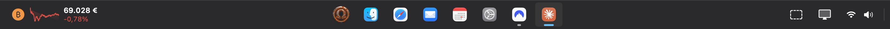
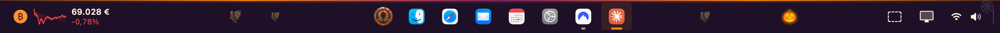

# OmniBar

**English** · [Italiano](README.it.md)

A Windows-style taskbar for macOS: a bottom bar with a Start menu of recent apps, a list of each app's open documents, recent files, a Bitcoin widget and themes. Native Swift/SwiftUI + AppKit, public APIs only, no third-party dependencies.




Available in **English** and **Italian**: OmniBar follows the language set in macOS.

## Features

- **Start menu**: recently used apps, *Recommended* recent files, *All apps*, and search across apps **and files** (Return opens, ↑↓ to select), plus a power menu.
- **Pinned and running apps** in one bar, with an active-app indicator. Apps that aren't pinned only show up while they have open windows.
- **Per-app document list**: hover or click an icon to see every open document of that app, minimised ones included. Click one to bring it to the front, or close it with ✕.
- **Recent documents** (jump lists) in each app's right-click menu, e.g. Word, Excel or a PDF reader.
- **Pin folders and files** by dragging them onto the bar.
- **Screenshots** of a region or of the whole screen, saved to disk and copied to the clipboard.
- **Bitcoin widget**: price in euro, 24-hour change and sparkline. Click it for a chart from 24 hours to 1 year (data from CoinGecko).
- **Quick settings**: network, volume, battery, theme.
- **Show desktop** strip on the right edge.
- **Themes**: System, Light, Dark, **Halloween** 🎃, **Christmas** 🎄 (falling snow, twinkling lights) and **Santa** 🎅 (a night sky with Santa's sleigh flying across the bar).
- **Global shortcuts**: ⌃⌥1…9 opens the n-th app, ⌃⌥Space opens Start, ⌃⌥D shows the desktop.
- **Launch at login**, from the bar's right-click menu.

| Document list | Bitcoin | Quick settings |
|---|---|---|
|  |  |  |

## Requirements

macOS 14 (Sonoma) or later, on Apple silicon or Intel.

## Installation

### From a release
1. Download `OmniBar.zip` from [Releases](../../releases), unzip it and move `OmniBar.app` to **Applications**.
2. The app isn't notarised by Apple, so macOS blocks it on first launch. Open **System Settings › Privacy & Security** and click **Open Anyway**.

### From source
Apple's Command Line Tools are enough (`xcode-select --install`); Xcode is not required.

```sh
./scripts/bundle.sh            # builds build/OmniBar.app
./scripts/bundle.sh universal  # Apple silicon + Intel
open build/OmniBar.app
```

## Permissions

Grant them in **System Settings › Privacy & Security**.

| Permission | What it's for |
|---|---|
| **Accessibility** | Listing open windows and documents, bringing them to the front, restoring and closing them |
| **Screen Recording** | Window titles and screenshots |
| **Automation › System Events** | Sleep, Restart, Shut Down and Log Out from the Start menu (asked on first use) |

With ad-hoc signing, macOS may ask for the permissions again after every rebuild. To avoid that, sign with a stable identity: set `OMNIBAR_SIGN_IDENTITY`, or create `scripts/signing.local` containing `OMNIBAR_SIGN_IDENTITY="Your identity"`.

## Privacy & security

- **No telemetry, no accounts.** The only network request goes to the public CoinGecko API over HTTPS, for the Bitcoin price; it carries no information about you.
- **Permissions are used locally only.** Accessibility lists, raises and closes windows and reads which document each window shows; Screen Recording provides window titles and screenshots. Nothing leaves your Mac.
- **What OmniBar stores on your Mac:**
  - settings and the lists of recent apps and recent documents (file paths), in `~/Library/Preferences/app.omnibar.OmniBar.plist`;
  - screenshots, in the folder macOS uses for screenshots;
  - a small diagnostic log, `~/Library/Logs/OmniBar.log`: start-up and errors only, never window titles or file names, capped at 1 MB.
- **Commands it runs:** `screencapture` for screenshots, `pmset displaysleepnow` to lock the screen, System Events for Sleep, Restart, Shut Down and Log Out, and `defaults write com.apple.dock autohide` + `killall Dock` only when you choose *Automatically Hide the Dock*.
- **No third-party dependencies**, and the source code is open.
- **Verify your download.** The app is not notarised by Apple, so each release lists the SHA-256 checksum of `OmniBar.zip`. Compare it with `shasum -a 256 OmniBar.zip`.
- **Remove everything:** quit OmniBar, delete the app, then run `defaults delete app.omnibar.OmniBar` and delete `~/Library/Logs/OmniBar*.log`.

## Known limitations

- macOS doesn't let an app reserve space at the edge of the screen, so maximised windows can extend under the bar. Hiding the Dock automatically helps (right-click the bar › *Automatically Hide the Dock*).
- Tabs inside one window (e.g. several PDFs in tabs) appear as a single document.
- Only windows on the current Space are listed.
- Other apps' menu bar icons don't appear in the tray.
- The bar is shown on the main display only.
- To read the windows of some apps (e.g. Microsoft Office), OmniBar turns on their accessibility interface; in rare cases this can slow down window animations in those apps.

## Development

- `.build/debug/OmniBar --snapshot <folder>` saves PNGs of the bar and its panels, then quits.
- `scripts/social-preview.swift` renders the repository's social preview image.
- Only public macOS APIs are used: NSWorkspace, Accessibility, ScreenCaptureKit, Spotlight (NSMetadataQuery), CoreAudio, IOKit, Carbon (global hotkeys) and ServiceManagement.


## License

[MIT](LICENSE) © 2026 csvnm
